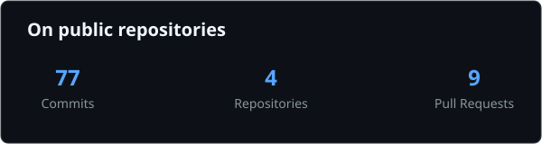

# Kyohkotsu

Software engineering student and part-time Japanese language teacher based in Montréal, Canada.

Interested in systems programming, algorithms, automation, and open-source software.

## Technologies

**Languages:** C, Java, Python, JavaScript, SQL, Rust (learning)

**Systems & scripting:** Linux, Bash, Markdown, LaTeX

**Tools:** Git, GitHub, Subversion, Docker

**Editors & IDEs:** Zed, VS Code, IntelliJ IDEA, Android Studio, Visual Studio

## Current Interests

- Systems programming and algorithms
- Linux customization
- Automation with Python
- CI/CD and distributed systems

## GitHub Activity

